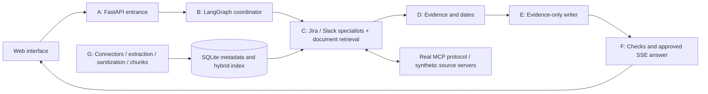

# int_mcp_agent — Engineering Atlas

A runnable implementation of the engineering-assistant design in `docs/architecture/`: ask questions across Jira, Slack and documents, inspect cited sources, upload knowledge, and ask follow-ups in a temporary session.

The default runs entirely on your computer with **synthetic Jira/Slack records, deterministic planning, extractive answers and offline hashed embeddings**. It uses real MCP protocol calls and a real LangGraph workflow. No API keys are required. Optional OpenAI mode adds model-based planning, bounded specialist decisions and evidence selection; it still uses synthetic Jira/Slack sources.

## Start on Windows

From this folder:

```powershell
.\scripts\start.ps1
```

Or, with the environment already installed:

```powershell
.venv\Scripts\python.exe -m src
```

Open **http://localhost:8000**. The API docs are at **http://localhost:8000/docs**. The UI uses the local development token `local-demo-token`; change it in `.env` and the UI connection settings together if desired.

Linux/macOS: `sh scripts/start.sh`. Python 3.11+ is required. A first install needs network access to download dependencies. The normal demo does not access external services.

Try:

- Why is the Payments release delayed, and where is its rollout guide?
- What is the status of PAY-123?
- Who owns Payments?
- How do I create a new capability?
- What is the capital of France? (Expected: insufficient evidence.)

## What is included

- Responsive web UI with streaming progress, citations, local document preview, knowledge management, temporary conversations and content-free activity records.
- FastAPI entrance with bearer authentication, optional verified JWT validation, request/upload limits, admission control and safe errors.
- LangGraph coordination, parallel source reads, one bounded refinement round, source status envelopes and an atomic shared call budget.
- Official MCP SDK Jira/Slack servers using separate processes or authenticated loopback Streamable HTTP, strict read-only tool catalogs, company-wide source filtering and adversarial fixtures.
- Markdown/text, HTML/web, PDF, Word `.docx`, CSV/JSON and explicit Google Drive connector support; bounded extraction preserves sections and pages.
- Incremental ingestion, sanitized chunks, hybrid keyword/vector retrieval, persistent SQLite index, atomic publication, revision checks, revocation and durable ingestion job primitives.
- Optional FAISS/OpenSearch adapters. SQLite remains the metadata authority; see [ingestion guide](docs/ingestion-guide.md).
- Citations built from approved source metadata. Every released factual excerpt must occur in its cited evidence. Raw drafts are never streamed.
- Expiring, owner-bound memory with fresh evidence on follow-up and revocation checks on both release and saved-history access. No answer-cache reuse.
- Automated protocol, ingestion, workflow and security tests, golden-question evaluations and CI configuration.

## Architecture



The letters correspond to the supplied design. The original documents describe both an earlier indexed-only system and a proposed redesign; this implementation follows the A–G redesign. [Implementation status](docs/implementation-status.md) distinguishes local capabilities from remaining enterprise release gates.

## Configuration

Copy `.env.example` to `.env` to override defaults. Never commit credentials. Important settings:

| Setting | Default | Purpose |
|---|---|---|
| `MODEL_MODE` | `demo` | `openai` enables approved model calls |
| `APPROVED_MODEL_PROCESSING` | `false` | Explicit provider-processing approval |
| `OPENAI_API_KEY` | unset | Required only for OpenAI mode |
| `OPENAI_MODEL` | `gpt-4.1-mini` | Configurable structured-output model |
| `MCP_TRANSPORT` | `stdio` | `http` connects to local servers on 8011/8012 |
| `DATA_DIR` | `data/runtime` | Persistent sanitized document index |
| `VECTOR_BACKEND` | `sqlite` | Optional `faiss` or approved `opensearch` |
| `AUTH_MODE` | `demo` | Optional `jwt` issuer/audience/JWKS validation |
| `REQUEST_TIMEOUT` | `30` | Total request deadline in seconds |
| `MAX_TOOL_CALLS` | `8` | Shared cap across source branches and refinement |
| `SESSION_TTL_SECONDS` | `3600` | Temporary memory expires after inactivity |

OpenAI mode uses [structured outputs](https://developers.openai.com/api/docs/guides/structured-outputs). It has not been tested against a paid provider in this workspace. Offline embeddings use signed token hashing, not learned semantic representations. Switching embedding models requires a fresh index.

To exercise HTTP MCP, run these in separate terminals:

```powershell
.venv\Scripts\python.exe -m src.integrations.mcp.server jira --transport streamable-http
.venv\Scripts\python.exe -m src.integrations.mcp.server slack --transport streamable-http
```

Set `MCP_TRANSPORT=http` in `.env` and restart the app. The default stdio mode starts and closes real server processes for each source branch automatically.

## API

All `/api/*`, question and detailed health routes require `Authorization: Bearer local-demo-token` in demo mode. Actor identity is derived from authentication; requests cannot choose it.

| Method and path | Behavior |
|---|---|
| `POST /ask` or `/api/ask` | `{ "question": "...", "session_id": "optional" }` → checked JSON answer |
| `POST /ask/stream` or `/api/chat` | Same body → `progress`, `answer`/`error`, then `done` SSE |
| `GET /api/documents` | Eligible published document inventory |
| `POST /api/documents/upload` | Multipart `file`; admin-only company-wide ingestion |
| `GET /api/documents/{id}/content` | Sanitized text, authenticated |
| `DELETE /api/documents/{id}` | Admin-only serving block and derivative cleanup |
| `GET /api/sessions`, `GET/DELETE /api/sessions/{id}` | Owner-bound temporary memory |
| `GET /api/activity` | Request outcomes, source names and duration; no question text |
| `GET /health/live` | Minimal unauthenticated liveness |
| `GET /health/ready`, `/api/health` | Current index readiness and mode |

```powershell
Invoke-RestMethod http://localhost:8000/ask -Method Post `
  -Headers @{Authorization='Bearer local-demo-token'} `
  -ContentType 'application/json' `
  -Body '{"question":"Why is PAY-123 blocked?"}'
```

## Tests and evaluation

```powershell
.venv\Scripts\python.exe -m pip install -r requirements-dev.lock
.venv\Scripts\python.exe -m pytest -q
.venv\Scripts\python.exe -m ruff check src tests
.venv\Scripts\python.exe -m src.eval.harness --fail-under 0.8
```

The golden set is small and synthetic; matching expected facts is a regression signal, not proof of general factual accuracy. Tests cover real local MCP traffic, authorization, untrusted content, budgets, safe streams, version publication, failed ingestion and deletion. Local latency is not a production capacity claim.

`requirements-all.lock` includes the optional search backends and development tools.
Run `python scripts/ui_smoke.py` for desktop/mobile browser checks; it uses an installed
Edge/Chrome or Playwright Chromium and saves screenshots to `artifacts/`.

## Deployment and operations

`docker compose -f infra/docker-compose.yml up --build` defines a single-replica local demo behind Nginx with persistent sanitized data. The API stays on loopback inside the shared network namespace, and the proxy is published only on host loopback. Docker has not been validated unless listed in [verification results](docs/verification.md).

Use [operations notes](docs/operations.md) for persistence, recovery, optional integrations and known limits. `APP_ENV=production` deliberately refuses startup while enterprise source adapters, approved identity/retention, distributed limits and production validation remain unresolved in the supplied design.

